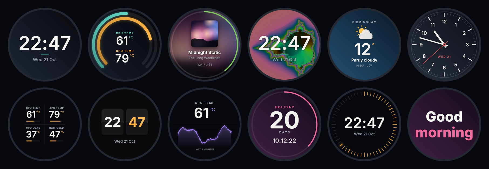

<div align="center">


# Cooler Screen

**Your cooler's screen, without iCUE.**

GIFs, pictures, clocks, live PC stats, now playing and weather on the round screen of the
**CORSAIR NAUTILUS RS LCD**, from one small app with no drivers and no background services.

**[Download for Windows](https://github.com/bhxuk/Corsair_Cooler_Screen/releases/latest/download/CoolerScreen-Setup.exe)**  ·  [Website](https://bhxuk.github.io/Corsair_Cooler_Screen/)  ·  [User guide](docs/USER-GUIDE.md)  ·  [What's new](CHANGELOG.md)



</div>

---

## Why

The NAUTILUS RS LCD's screen is normally driven by iCUE, which is big and runs several background services.

Cooler Screen does the one job iCUE was needed for, on its own:

- **Only touches the cooler's screen.** It looks for USB ID `1B1C:0C57` (or `0C55`) and nothing else, matching the ID before opening anything.
- **No drivers, no services, no admin rights.** It uses Windows' own built-in USB (HID) support, opened shared so nothing else is locked out.
- **Fans and pump carry on as normal.** They're on your motherboard's PWM headers and follow your BIOS curves.

## What it can show

| | |
|---|---|
| **Pictures and GIFs** | Any picture or animated GIF/WebP, filled to the circle, with zoom, position, speed and darken. Or a slideshow of a whole folder. |
| **Clocks** | Digital, Stacked, Flip, Seconds ring, Analog, Analog minimal and Two time zones. |
| **PC stats** | Gauge, Two rings, Grid of four, Big number, Bars and a two-minute Graph. CPU and GPU temperature and load, memory, power, clocks, drive temperature and network speed, turning amber and red as things heat up. |
| **Now playing** | The song in Spotify, a browser or anything on Windows' media controls, with artwork and progress round the edge. |
| **Weather** | Your town's weather from Open-Meteo. |
| **Countdown and messages** | Days to a date, or your own words, still or scrolling. |

Mix any background with anything on top: a GIF behind a clock, stats over a photo.

## Playlist and automations

- **Playlist**: rotate through screens, in order or shuffled.
- **Too-hot alert**: a pulsing red warning takes over when a temperature stays too high.
- **When an app is running**: show GPU stats while a game is open.
- **Night time**: dim or switch off the screen overnight.
- **When the PC is locked**: change the screen or turn it off.

## Temperatures

Windows doesn't let ordinary apps read CPU temperatures. If [Sector](https://github.com/bhxuk/Sector) is installed, Cooler Screen uses its agent for exact hardware readings. Otherwise it uses what Windows offers any app: CPU and GPU load, memory, network, NVIDIA GPU sensors and an approximate CPU temperature.

## Install

1. Download **[CoolerScreen-Setup.exe](https://github.com/bhxuk/Corsair_Cooler_Screen/releases/latest/download/CoolerScreen-Setup.exe)** and run it. No admin rights needed.
2. If Windows shows "Windows protected your PC", click **More info**, then **Run anyway** (the app isn't code-signed).
3. If iCUE is installed, uninstall it or turn off its LCD control, so the two don't fight over the screen.

A standalone **[CoolerScreen.exe](https://github.com/bhxuk/Corsair_Cooler_Screen/releases/latest/download/CoolerScreen.exe)** is also on every release.

Needs Windows 10 (2004 or later) or Windows 11, 64-bit, and the cooler's USB cable on a USB 2.0 header.

## Building

```
dotnet publish src/CoolerScreen/CoolerScreen.csproj -c Release -r win-x64 --self-contained true -p:PublishSingleFile=true -p:IncludeNativeLibrariesForSelfExtract=true
```

| Folder | What's in it |
|---|---|
| `src/CoolerScreen.Render` | Draws the 480 × 480 screens with SkiaSharp. No Windows-only code. |
| `src/CoolerScreen` | The Windows app: USB connection, sensors, the display engine and the window. |
| `tools/Preview` | Renders every screen style to PNG (used for the website and to check the drawing). |
| `installer` | The Inno Setup script. GitHub Actions builds `CoolerScreen-Setup.exe` on every version. |

### How the screen is driven

Each frame is a 480 × 480 JPEG split into 1,024-byte HID output reports (report `0x02`, an 8-byte header with the packet number, a last-packet flag and the length, then up to 1,016 bytes of picture). Brightness (`0x03 0x0B`), rotation (`0x03 0x0C`) and handing the screen back to the cooler (`0x03 0x1E`, `0x03 0x1D`) are HID feature reports. Thanks to the [OpenLinkHub](https://github.com/jurkovic-nikola/OpenLinkHub) project, whose Linux support for the NAUTILUS LCD cap documents the protocol.

## Not affiliated

Cooler Screen isn't made by or connected with Corsair. CORSAIR, NAUTILUS and iCUE are trademarks of Corsair. Use it at your own risk.

## Licence

MIT
